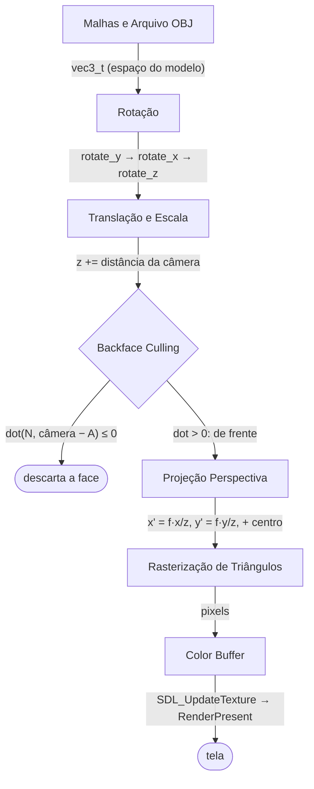

# Pipeline de Renderização

> [!abstract] Resumo
> Cada frame, cada vértice passa pelo mesmo caminho até virar pixel:
> **modelo → transformar → (culling) → projetar → rasterizar → apresentar**.



> [!tip] Clique nos nós
> Cada caixa abre a nota correspondente: [[Malhas e Arquivo OBJ]] · [[Rotação]] · [[Translação e Escala]] · [[Backface Culling]] · [[Projeção Perspectiva]] · [[Rasterização de Triângulos]] · [[Color Buffer]]

## Widget — o pipeline inteiro num cubo
```dataviewjs
dv.view("_widgets/cube")
```

## Código (resumo do `update()`)
```c
for (int i = 0; i < num_faces; i++) {
  face_t face = mesh.faces[i];
  vec3_t v[3] = { mesh.vertices[face.a - 1], mesh.vertices[face.b - 1], mesh.vertices[face.c - 1] };

  for (int j = 0; j < 3; j++) {
    v[j] = vec3_rotate_y(v[j], mesh.rotation.y);
    v[j] = vec3_rotate_x(v[j], mesh.rotation.x);
    v[j] = vec3_rotate_z(v[j], mesh.rotation.z);
    v[j].z -= camera_position.z;           // afasta da câmera
  }
  // (backface culling aqui, com v[] já transformados)
  for (int j = 0; j < 3; j++) {
    vec2_t p = project(v[j]);
    p.x += window_width / 2.0;  p.y += window_height / 2.0;
    projected_triangle.points[j] = p;
  }
  array_push(triangles_to_render, projected_triangle);
}
```

> [!warning] Pegadinhas
> - **Ordem importa**: rotacionar *antes* de transladar (senão gira em volta da câmera).
> - Culling usa os vértices **3D transformados**, antes da projeção.

## Ver também
- [[Rotação]] · [[Translação e Escala]] · [[Backface Culling]] · [[Projeção Perspectiva]]
- [[DDA]] · [[Bresenham]] · [[Rasterização de Triângulos]] · [[Color Buffer]] · [[🏠 Início]]
